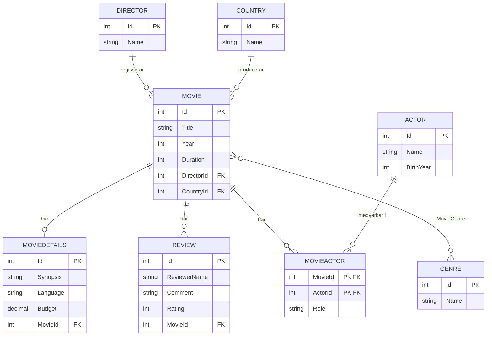
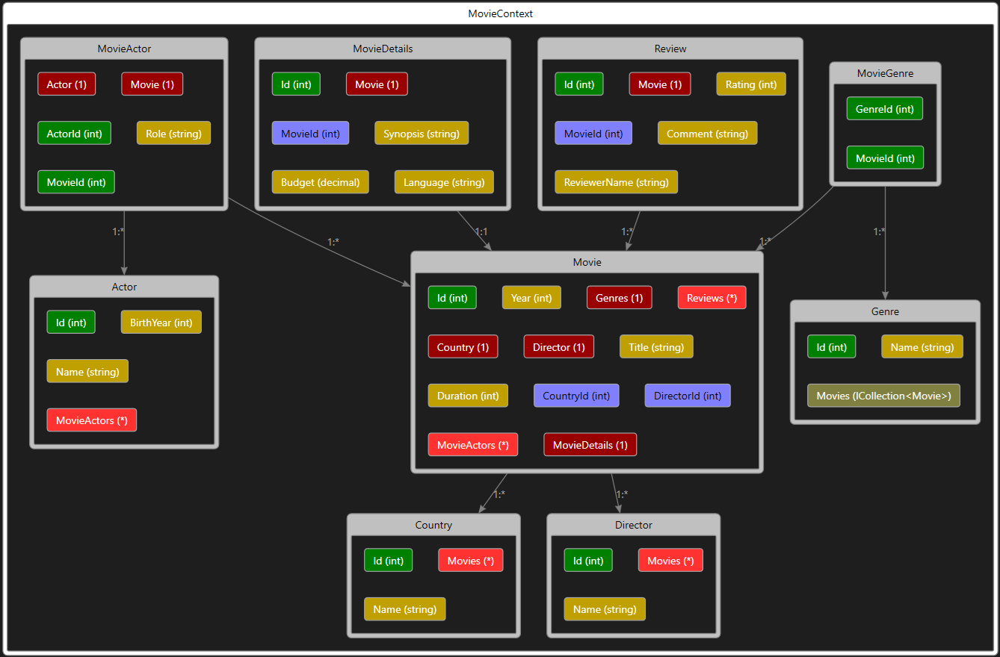

# MovieApi

Ett REST-API för filmer, skådespelare, recensioner och statistik, byggt med **ASP.NET Core Web API** och **Entity Framework Core**.

Projektet är en övning i .NET-utbildningen och första steget i en serie uppgifter. Det är byggt som en monolit och ska i en senare version göras om till clean architecture.

## Teknik

| | |
|---|---|
| Ramverk | .NET 10, ASP.NET Core Web API (controllers) |
| ORM | Entity Framework Core 10 |
| Databas | SQL Server LocalDB |
| Dokumentation | OpenAPI |
| Testning | Postman |
| Diagram | EF Core Power Tools |

## Kom igång

### Krav

- .NET 10 SDK
- Visual Studio 2026 (eller annan IDE) med SQL Server LocalDB

### Starta projektet

1. Klona repot
   ```bash
   git clone https://github.com/irlmonster/MovieApi.git
   ```
2. Öppna `MovieApi.slnx` i Visual Studio
3. Skapa databasen. I **Package Manager Console**:
   ```
   Update-Database
   ```
   Eller med .NET CLI:
   ```bash
   dotnet ef database update --project MovieApi
   ```
4. Starta med `F5`

När appen startar i Development-läge fylls databasen automatiskt med testdata (13 filmer från fyra länder, med regissörer, skådespelare, roller, genrer och recensioner). Seedingen körs bara om databasen är tom.

Connection string finns i `appsettings.json` under `ConnectionStrings:MovieContext`.

### Börja om från början

```
Drop-Database
Update-Database
```

Starta sedan appen igen så seedas databasen på nytt.

## Datamodell



| Relation | Typ | Kommentar |
|---|---|---|
| Movie ↔ MovieDetails | 1:1 | Unikt index på `MovieId` |
| Movie → Review | 1:M | Recensioner tas bort med filmen |
| Movie ↔ Actor | N:M | Via `MovieActor`, egen entitet med `Role` och sammansatt nyckel |
| Movie ↔ Genre | N:M | Via kopplingstabellen `MovieGenre` |
| Movie → Director | M:1 | `Restrict`: en regissör med filmer kan inte tas bort |
| Movie → Country | M:1 | `Restrict`: ett land med filmer kan inte tas bort |

All konfiguration görs med **Fluent API** i separata klasser under `Data/Configurations` (`IEntityTypeConfiguration<T>`), så att modellklasserna hålls fria från databasattribut.

### DbContext-diagram

Diagrammet nedan är genererat från `MovieContext` med **EF Core Power Tools** (Add DbContext Diagram). Källfilen ligger i `MovieApi/MovieContext.dgml` och kan öppnas i Visual Studio med DGML-editorn.



## Endpoints

### Movies

| Metod | Route | Beskrivning |
|---|---|---|
| GET | `/api/movies` | Alla filmer |
| GET | `/api/movies/{id}` | En film |
| GET | `/api/movies/{id}/details` | En film med detaljer, recensioner och skådespelare med roller |
| POST | `/api/movies` | Skapa film (inklusive MovieDetails) |
| PUT | `/api/movies/{id}` | Uppdatera film |
| DELETE | `/api/movies/{id}` | Ta bort film |

**Filtrering** på `GET /api/movies` med query-parametrar, som kan kombineras:

```
GET /api/movies?genre=Drama
GET /api/movies?year=1994
GET /api/movies?actor=Tom+Hanks
GET /api/movies?genre=Drama&year=1998
```

### Actors

| Metod | Route | Beskrivning |
|---|---|---|
| GET | `/api/actors` | Alla skådespelare |
| GET | `/api/actors/{id}` | En skådespelare |
| POST | `/api/actors` | Skapa skådespelare |
| PUT | `/api/actors/{id}` | Uppdatera skådespelare |
| POST | `/api/movies/{movieId}/actors` | Lägg till skådespelare i film, med roll |

### Reviews

| Metod | Route | Beskrivning |
|---|---|---|
| GET | `/api/movies/{movieId}/reviews` | Recensioner för en film |
| POST | `/api/movies/{movieId}/reviews` | Skriv recension |
| DELETE | `/api/reviews/{id}` | Ta bort recension |

### Reports

| Metod | Route | Beskrivning |
|---|---|---|
| GET | `/api/reports/genres/popular` | Genrer sorterade efter antal filmer |
| GET | `/api/reports/movies/with-most-reviews` | Filmen med flest recensioner |
| GET | `/api/reports/movies/longest-per-country` | Längsta filmen i varje land |
| GET | `/api/reports/actors/most-active` | Topp 5 skådespelare efter antal filmer |
| GET | `/api/reports/movies/average-ratings` | Snittbetyg och antal recensioner per genre |
| GET | `/api/reports/movies/top5pergenre` | De fem bäst betygsatta filmerna i varje genre |

## Exempel

Id:n för genrer, regissörer och länder beror på i vilken ordning de seedades. Kontrollera dem i databasen om exemplen ger 400.

### Skapa en film

`POST /api/movies`

```json
{
  "title": "Back to the Future",
  "year": 1985,
  "duration": 116,
  "genreIds": [2, 4],
  "directorId": 2,
  "countryId": 1,
  "synopsis": "A teenager accidentally travels back in time in a DeLorean.",
  "language": "English",
  "budget": 19000000
}
```

### Lägg till skådespelare i film

`POST /api/movies/1/actors`

```json
{
  "actorId": 3,
  "role": "Agent Smith"
}
```

### Skriv en recension

`POST /api/movies/1/reviews`

```json
{
  "reviewerName": "Mats",
  "comment": "En klassiker.",
  "rating": 5
}
```

## Validering och statuskoder

Alla controllers har `[ApiController]`, vilket ger automatisk validering av DTOs. Bryter en request mot reglerna nedan returneras **400 Bad Request** innan controllern körs.

| Fält | Regel |
|---|---|
| Title | Obligatorisk, max 100 tecken |
| Year | 1888 till 2100 |
| Duration | 1 till 800 minuter |
| DirectorId, CountryId, ActorId | Minst 1 |
| Rating | 1 till 5 |
| Role | Obligatorisk, max 100 tecken |

| Kod | När |
|---|---|
| 200 OK | Lyckad hämtning |
| 201 Created | Resurs skapad (med `Location`-header) |
| 204 No Content | Lyckad uppdatering, borttagning eller koppling |
| 400 Bad Request | Valideringsfel, eller genre/regissör/land som inte finns |
| 404 Not Found | Film, skådespelare eller recension med angivet Id finns inte |
| 409 Conflict | Skådespelaren är redan kopplad till filmen |

## Projektstruktur

```
MovieApi/
├── Controllers/
│   ├── MoviesController.cs
│   ├── ActorsController.cs
│   ├── ReviewsController.cs
│   └── ReportsController.cs
├── Data/
│   ├── MovieContext.cs
│   └── Configurations/        Fluent API, en klass per entitet
├── DTOs/
│   ├── Actors/
│   ├── Movies/
│   ├── Reviews/
│   └── Reports/
├── Extensions/
│   └── SeedDataExtensions.cs  app.SeedData()
├── Migrations/
├── Models/                    Entiteter
├── MovieContext.dgml          Diagram från EF Core Power Tools
└── Program.cs
docs/
└── dbcontext-diagram.png      Skärmdump av diagrammet
```

## Designval

- **DTOs för all in- och utdata.** Entiteter skickas aldrig direkt ut ur API:et. Det förhindrar cirkulära referenser vid serialisering och gör att klienten bara ser det den behöver. Separata DTOs för POST och PUT så att reglerna kan skilja sig åt.
- **Projektion med `Select`.** Läsningar bygger DTOs direkt i LINQ-frågan, så att EF Core bara hämtar de kolumner som behövs.
- **Fluent API istället för data annotations** för databasregler. Annotations används bara för validering i DTOs.
- **Manuell mappning** istället för AutoMapper, för att tydligt se hur data flyttas mellan entitet och DTO.
- **Seeding med extension-metod**, där objekten byggs ihop via navigation properties och EF sätter Id:n och kopplingar.

README skriven med hjälp av AI utifrån projektets kod, granskad av mig.